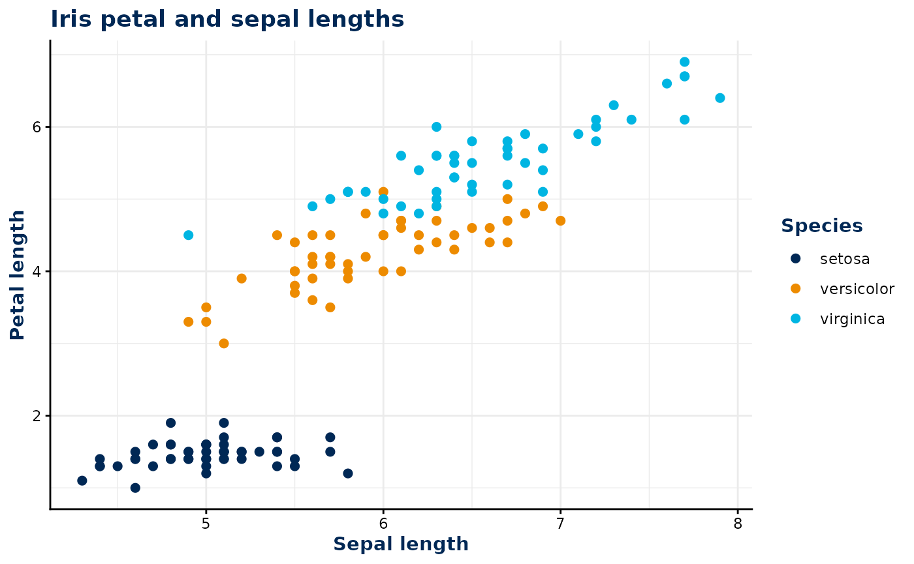
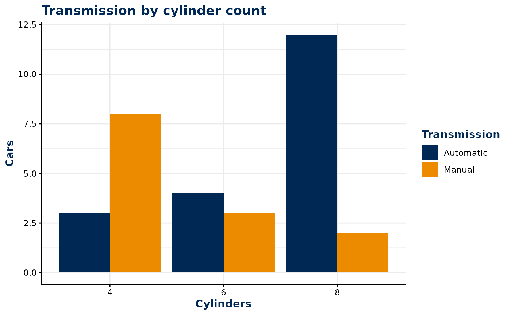
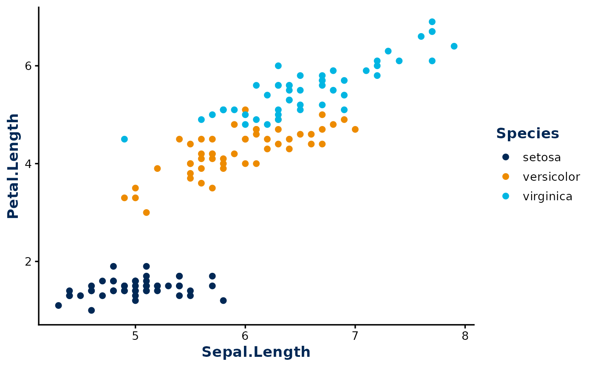

# Styling figures and tables

``` r

library(bsu.tools)
library(ggplot2)
```

`bsu.tools` provides themes and scales for applying UC Davis Health
styling to ggplot2 figures and flextable tables.

## ggplot2 styling

Add the ggplot2 theme and scales to a plot with `+`, just like other
ggplot2 components.

### Style points with color

Use
[`scale_color_ucdh()`](https://ucdavis.github.io/bsu.tools/reference/scale_colour_ucdh.md)
when a discrete variable is mapped to the `color` aesthetic.
[`theme_ucdh()`](https://ucdavis.github.io/bsu.tools/reference/theme_ucdh.md)
styles the plot text, grid, legend, and facet strips.

``` r

ggplot(
  iris,
  aes(Sepal.Length, Petal.Length, color = Species)
) +
  geom_point(size = 2) +
  labs(
    title = "Iris petal and sepal lengths",
    x = "Sepal length",
    y = "Petal length"
  ) +
  scale_color_ucdh() +
  theme_ucdh()
```



### Style areas with fill

Use
[`scale_fill_ucdh()`](https://ucdavis.github.io/bsu.tools/reference/scale_colour_ucdh.md)
for discrete `fill` mappings, such as groups in a bar chart.

``` r

ggplot(
  mtcars,
  aes(factor(cyl), fill = factor(am))
) +
  geom_bar(position = "dodge") +
  labs(
    title = "Transmission by cylinder count",
    x = "Cylinders",
    y = "Cars"
  ) +
  scale_fill_ucdh(
    name = "Transmission",
    labels = c("Automatic", "Manual")
  ) +
  theme_ucdh()
```



### Customize the theme

The `base_size` and `base_family` arguments control the text, while
`grid_lines = FALSE` removes the panel grid. For example:

``` r

ggplot(
  iris,
  aes(Sepal.Length, Petal.Length, color = Species)
) +
  geom_point(size = 2) +
  scale_color_ucdh() +
  theme_ucdh(base_size = 13, grid_lines = FALSE)
```



## flextable styling

Use
[`theme_flextable_ucdh()`](https://ucdavis.github.io/bsu.tools/reference/theme_flextable_ucdh.md)
to style a flextable with a navy and gold header and navy body text. The
first column is also bolded.

``` r

iris |>
  dplyr::summarise(
    `Sepal Width`  = mean(Sepal.Width), `Sepal Length` = mean(Sepal.Length),
    `Petal Width` = mean(Petal.Width), `Petal Length` = mean(Petal.Length),
    .by = Species
  ) |>
  flextable::flextable() |>
  theme_flextable_ucdh()
```

| Species    | Sepal Width | Sepal Length | Petal Width | Petal Length |
|------------|-------------|--------------|-------------|--------------|
| setosa     | 3.428       | 5.006        | 0.246       | 1.462        |
| versicolor | 2.770       | 5.936        | 1.326       | 4.260        |
| virginica  | 2.974       | 6.588        | 2.026       | 5.552        |
